# Resultados del experimento principal: MQTT vs HTTP(S) con 8 ESP32 en QEMU

Análisis de la matriz completa (`matrices/principal.yaml`): 42 configuraciones × 5 repeticiones = **210
corridas de 120 s**, todas válidas. Los datos crudos están en `datos/principal/`, las
métricas por corrida en `datos/principal/metrics.csv`, el resumen por configuración (media ±
desvío, n−1) en `datos/principal/summary.csv`, y los gráficos y tablas en [`figs/`](figs/), junto a este documento
(generados con `analysis/figuras.py`). Las demás rutas son relativas a `experimento/`.

Qué mide cada métrica y cómo se calcula está en el comentario inicial de `backend/cmd/analyze/main.go`.

## Resumen

| | MQTT QoS 0 | MQTT QoS 1 | HTTP reutilizado | HTTP por request |
|---|---|---|---|---|
| Bytes IP por lectura (TLS, base) | **165** | 238 | 555 | 2596 (2296 sin retransmisiones espurias) |
| Bytes IP por lectura (sin TLS) | **119** | 162 | 458 | 742 |
| Paquetes por lectura (TLS) | **2,25** | 3,19 | 6,08 | 22,5 |
| Latencia p50 (TLS) | **2,9 ms** | 3,0 ms | 44,8 ms | 3383 ms |
| Entrega con 5 % de pérdida | 100 % | 100 % (52 duplicados) | 100 % | 100 % |
| Latencia p95 con 5 % de pérdida | 1,3 s | **1,0 s** | 3,8 s | 6,3 s |

*Base: 8 nodos, período de 1 s (10 s para HTTP por request), TLS 1.2, protobuf, sin pérdida ni latencia agregada.*

1. **MQTT es el camino más barato en bytes y en latencia.** Por lectura, QoS 0 gasta 3,4 veces
   menos bytes que HTTP con conexión reutilizada, y 14 a 16 veces menos que HTTPS con una
   conexión por lectura.
2. **El factor más pesado no es el protocolo de aplicación sino la conexión.** Abrir una conexión
   TCP+TLS por lectura explica el 82 % de la diferencia entre HTTPS por request y MQTT QoS 0. El
   protocolo (headers HTTP, respuesta obligatoria y ACKs) explica el 18 % restante.
3. **El costo de una conexión se reparte entre las lecturas que lleva.** Un modelo de dos términos,
   *bytes por lectura = v + C / n*, ajusta los datos con R² entre 0,97 y 1,00. MQTT tiene el costo
   por lectura `v` más bajo (140 B) pero el costo fijo por conexión `C` más alto (~3 KB). Por eso
   **MQTT gana mientras la conexión dure más de 3 a 4 lecturas**, y pierde si el nodo se reconecta
   en cada envío.
4. **HTTP reutilizado suma ~40 ms por lectura por Nagle + ACK retardado.** Es un efecto de cómo
   esp_http_client usa TCP, no de HTTP (ver [nagle.md](nagle.md)).
5. **Con pérdida de hasta 5 %, nadie pierde lecturas.** TCP retransmite todo. La hipótesis "QoS 0
   pierde lecturas" no se confirma en estas condiciones. Lo que cambia es la **cola de latencia**,
   y ahí el esquema pedido-respuesta de HTTP sale mucho peor.
6. **Protobuf ahorra los mismos ~54 B por lectura en todos los caminos.** En términos relativos
   pesa mucho más en MQTT (+33 % con JSON) que en HTTP (+9 %) o HTTPS por request (+3 %).

---

## 1. Cómo se corrió

- `sudo ./backend/bin/runner -matrix matrices/principal.yaml` del 26/10 21:07 al 27/10 04:48 (7 h 40 min),
  en orden aleatorio con semilla 42. El log está en `datos/principal/runner.log`.
- **208 de 210 corridas salieron bien al primer intento.** Las otras dos fallaron antes de
  medir: un nodo no logró sincronizar SNTP con 5 % de pérdida. Las causas:
  - Si se pierde el primer pedido (o el ARP), lwIP reintenta a los 15 s y después duplica la espera.
  - El firmware esperaba solo 30 s.

  Después de la falla (corrida 11) se amplió la espera a 90 s en `firmware/main/timesync.c`
  y se recompiló la imagen. Esto solo afecta el arranque, antes de `READY`, así que las
  corridas previas y posteriores miden lo mismo. Las dos corridas se repitieron al final y
  salieron bien. Además, `firmware/build.sh` ahora reemplaza `flash.bin` de forma atómica.
- **Validez:** las 210 corridas son válidas:
  - `rtf_min` = 1,000 en todas y 0 *overruns* (ningún nodo se atrasó produciendo);
  - 0 lecturas pendientes al final, 0 descartes de cola, 0 fallas de envío;
  - 0 desconexiones MQTT.

  Cada configuración tiene n = 5.

### Reloj y latencia

La latencia es `t_recv` (hora del servidor) − `t_us` (hora del nodo). Los dos relojes se unen por
SNTP contra el backend. Al revisar el offset de cada nodo (`nodes.csv`) aparece un sesgo
**exactamente igual a la mitad del RTT agregado**:

| RTT agregado | Offset mediano nodo − host |
|---|---|
| 0 ms | 1,11 ms (incluye el retardo de la UART emulada) |
| 50 ms | 26,03 ms |
| 200 ms | 101,03 ms |

La causa es que el cliente SNTP de lwIP se compila con `SNTP_COMP_ROUNDTRIP = 0`
(`components/lwip/lwip/src/include/lwip/apps/sntp_opts.h`). Toma la hora que manda el servidor
sin sumar el viaje de vuelta, así que el reloj del nodo queda atrasado un viaje de ida
(RTT/2). Eso **infla en RTT/2 la latencia medida** en las corridas con RTT agregado. Como
netem agrega un retardo fijo, sin jitter, la corrección es exacta: **en la sección de latencia
de red, las latencias se informan corregidas restando RTT/2** ([figs/07](figs/07_latencia_red.png), [figs/12](figs/12_cdf_latencia_rtt200.png)). Sin RTT
agregado, el error del reloj es del orden de 1 ms, así que las latencias de MQTT (~3 ms) deben
leerse con ±1 ms de incertidumbre absoluta. Las comparaciones entre transportes no se ven
afectadas.

---

## 2. Bytes por lectura (pregunta 1)

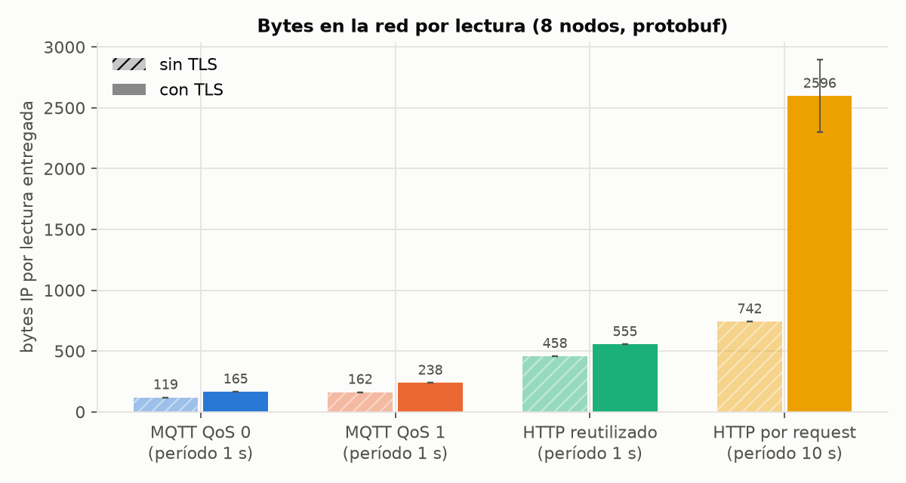

| Transporte | Sin TLS | Con TLS | Paquetes (TLS) | Subida / bajada por lectura (TLS) |
|---|---|---|---|---|
| MQTT QoS 0 | 118,7 ± 0,0 | 165,2 ± 0,1 | 2,25 | 109 / 56 B |
| MQTT QoS 1 | 162,1 ± 0,2 | 237,7 ± 0,2 | 3,19 | 150 / 88 B |
| HTTP reutilizado | 457,7 ± 0,2 | 555,0 ± 0,2 | 6,08 | 334 / 221 B |
| HTTP por request | 741,8 ± 0,0 | 2596 ± 298 | 22,5 | 1005 / 1591 B |

Intervalos de confianza del 95 % (t de Student, n = 5) en la base: MQTT QoS 0 165,2 ± 0,1 B;
MQTT QoS 1 237,7 ± 0,3 B; HTTP reutilizado 555,0 ± 0,3 B; HTTP por request 2596 ± 370 B.
Todas las diferencias entre transportes son significativas (Welch, p < 10⁻⁴; ver
[`figs/tablas.md`](figs/tablas.md)).

### De qué están hechos esos bytes

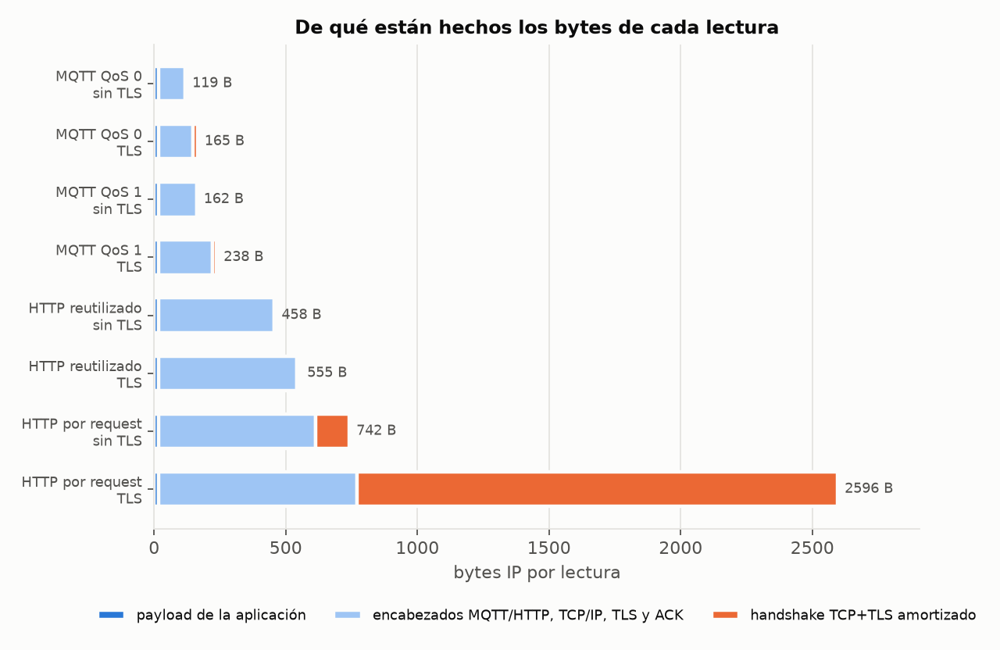

El payload protobuf (18 B) es el **11 % de una lectura MQTT QoS 0 con TLS** y menos del 1 % en
HTTPS por request. Todo lo demás son encabezados, ACKs y el handshake.

Anatomía en régimen estable, sacada de las capturas (`ip` = bytes del paquete IP):

**MQTT QoS 0 + TLS: 2 paquetes, 140 B.**
```
esp→srv  ip=100  PUBLISH exp/tel/3 (31 B MQTT + 29 B TLS + 40 B TCP/IP)
srv→esp  ip= 40  ACK
```

**MQTT QoS 1 + TLS: 3 paquetes, ~215 B.**
```
esp→srv  ip=102  PUBLISH (33 B: +2 del packet id)
srv→esp  ip= 73  PUBACK (4 B MQTT + 29 TLS + 40 TCP/IP), con el ACK incluido
esp→srv  ip= 40  ACK solo, ~83 ms después (ACK retardado de lwIP)
```

**HTTP reutilizado + TLS: 6 paquetes, ~543 B.**
```
esp→srv  ip=203  POST /tel/3 + headers (134 B HTTP)
srv→esp  ip= 40  ACK, 40 ms después            ← ACK retardado de Linux
esp→srv  ip= 87  cuerpo protobuf (18 B)        ← Nagle lo retuvo hasta ese ACK
srv→esp  ip= 40  ACK
srv→esp  ip=133  HTTP/1.1 204 No Content (64 B)
esp→srv  ip= 40  ACK, ~230 ms después          ← ACK retardado de lwIP
```

**HTTP por request + TLS: ~22 paquetes y una conexión completa por lectura.**
```
SYN / SYN-ACK / ACK                                    128 B
Client Hello (238 B)                ─┐
Server Hello + Certificate + SKE + Done (655 B)        │ handshake TLS 1.2
   ... el ESP32 calcula ECDHE + verifica ECDSA: ~3 s en QEMU ...
Client Key Exchange  ── 40 ms (Nagle) ──  CCS + Finished
CCS + Finished (servidor)           ─┘                 ~1525 B en total
POST + headers ── 40 ms (Nagle) ── cuerpo ── 204 ── close_notify ── FIN ── RST
```

Sin TLS, HTTP por request son 12 paquetes y 742 B: SYN, SYN-ACK, ACK, POST (153 B), ACK,
cuerpo, ACK, 204 (83 B), FIN, ACK, FIN y ACK.

### Costo fijo por conexión + costo por lectura

En los caminos con conexión persistente, lo que cambia con el período es cuántas lecturas
viajan por la misma conexión (n = lecturas por conexión durante los 120 s). Se ajustó
`bytes por lectura = v + C / n` sobre las 15 corridas de cada transporte (factor período,
con TLS):

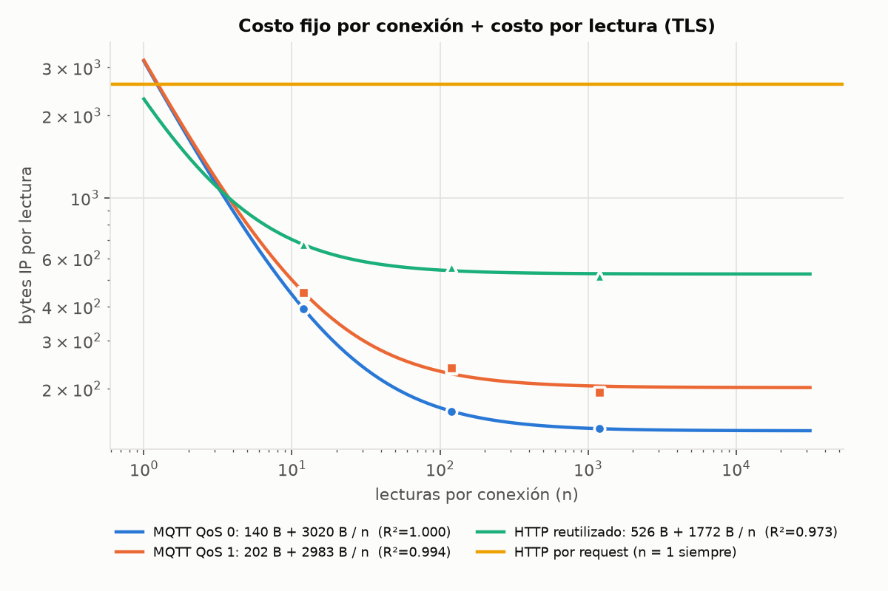

| Transporte | `v`: bytes por lectura | `C`: bytes fijos por conexión | R² |
|---|---|---|---|
| MQTT QoS 0 | **140** | 3020 | 1,000 |
| MQTT QoS 1 | 202 | 2983 | 0,994 |
| HTTP reutilizado | 526 | **1772** | 0,973 |
| HTTP por request | — | — | 2296 a 2596 B constantes (n = 1) |

- **`v` coincide con la anatomía:** 140 B en MQTT QoS 0 es exactamente PUBLISH (100) + ACK (40).
- **`C` es el handshake TCP+TLS más el arranque y el cierre de la sesión:** CONNECT/CONNACK de
  MQTT, close_notify y FIN.
- **`C` de MQTT es ~1250 B mayor que el de HTTP** por dos razones:
  - Mosquitto manda la cadena con el certificado de la CA: 856 B de certificados contra 445 B
    del servidor Go, +411 B.
  - Están los mensajes CONNECT/CONNACK.
- **Consecuencia práctica:** con menos de ~3 lecturas por conexión, MQTT con TLS es más caro
  que HTTP reutilizado. Con n = 1, el modelo da ~3160 B: más caro que un POST HTTPS
  (2296 B). Esto último es una extrapolación fuera del rango medido (n = 12 a 1200). Para un
  nodo que **duerme y se reconecta para cada envío**, la ventaja de MQTT desaparece si no se
  usa reanudación de sesión TLS, que en este experimento está desactivada en los dos caminos.
- El ajuste de HTTP reutilizado y MQTT QoS 1 es algo peor porque con período de 100 ms el
  ACK que el nodo manda solo a los ~230 ms viaja dentro del mensaje siguiente. Por eso
  `v` baja con períodos cortos: QoS 1 pasa de 3,19 a 2,43 paquetes por lectura y HTTP de 6,08
  a 5,25.

### Comparación con el mismo período (10 s)

HTTP por request solo se corrió con período de 10 s (con 1 s satura, ver [decisiones de diseño](../../README.md#decisiones-de-diseño)). Para
compararlo de igual a igual están las corridas de 10 s de los otros caminos:

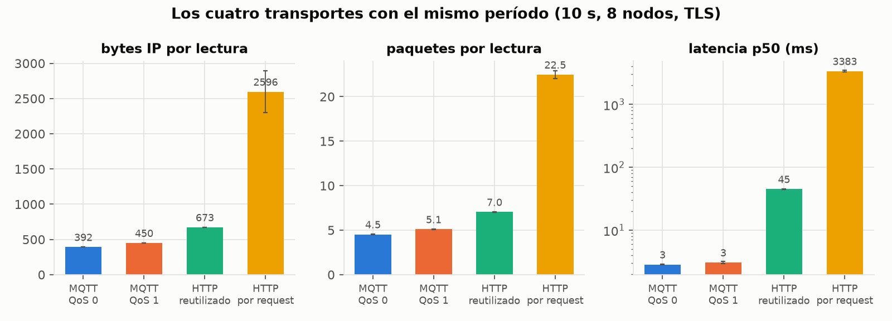

| A 10 s, TLS, 8 nodos | Bytes / lectura | Paquetes / lectura | Latencia p50 |
|---|---|---|---|
| MQTT QoS 0 | 392 ± 1 | 4,53 | 2,8 ms |
| MQTT QoS 1 | 450 ± 2 | 5,10 | 3,1 ms |
| HTTP reutilizado | 673 ± 2 | 7,04 | 45,0 ms |
| HTTP por request | 2596 ± 298 | 22,46 | 3383 ms |

Con solo 12 lecturas por conexión, el handshake pesa: es el 42 % de los bytes de MQTT QoS 0 a
10 s, contra el 10 % a 1 s.

### Proyección a un día

Con la conexión abierta en forma permanente (n → ∞, se usa `v`) y una lectura cada 10 s
(8640 por día y por nodo), sin contar keep-alive porque el período es menor que los 60 s
configurados:

| | Por nodo y por día | 1000 nodos, por mes |
|---|---|---|
| MQTT QoS 0 | 1,2 MB | 36 GB |
| MQTT QoS 1 | 1,7 MB | 52 GB |
| HTTP reutilizado | 4,5 MB | 136 GB |
| HTTP por request (TLS) | 19,8 MB | 595 GB |

---

## 3. Latencia y entrega (pregunta 2)

La entrega fue del **100 % en las 210 corridas**. La latencia es la de la primera llegada de cada
lectura.

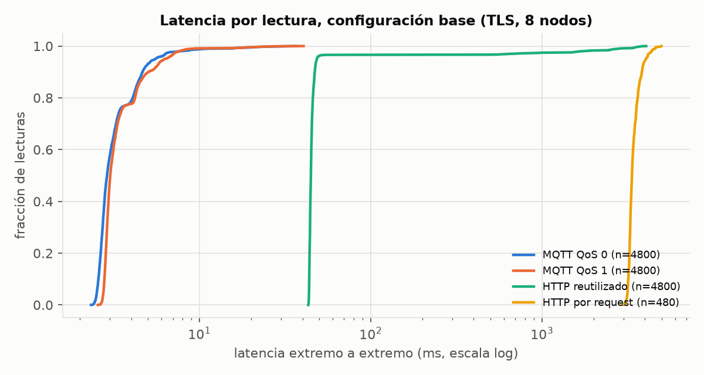

- **MQTT, QoS 0 y QoS 1: ~3 ms de mediana y p99 < 12 ms.** La diferencia entre QoS 0 y QoS 1 no
  es significativa (2,90 vs 3,02 ms, p = 0,06): la latencia se mide al llegar al servidor y no
  espera el PUBACK.
- **HTTP reutilizado: 44,8 ms de mediana, casi toda por Nagle.** Unos 40 ms son la espera entre
  headers y cuerpo descrita en [nagle.md](nagle.md). Con `TCP_NODELAY` baja a 5 ms.
- **HTTP reutilizado tiene una cola larga en p99 (2,7 s) que MQTT no tiene.** La causa es la
  conexión perezosa: esp_http_client abre la conexión recién con el primer envío, después de
  `READY`, mientras que esp-mqtt conecta antes.
  - La primera lectura de cada nodo espera el handshake TLS completo: 3,6 s de media contra
    21 ms en MQTT.
  - Desde la lectura 10 en adelante, HTTP reutilizado da p99 = 48 ms.
- **HTTP por request + TLS: 3,4 s de mediana.** Casi todo es el handshake con criptografía
  emulada: el ESP32 tarda ~3 s entre recibir el certificado y mandar el Client Key Exchange. En
  hardware real sería mucho menor, así que **este valor es relativo**. Sin TLS da 10 ms.

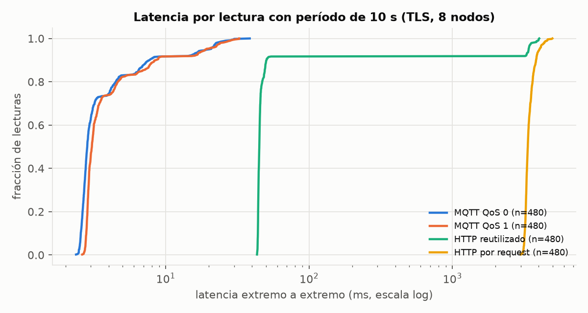

---

## 4. TLS y conexión persistente: qué explica la diferencia (pregunta 4)

### Lo que agrega TLS

| | Δ bytes / lectura | Δ relativo | Δ latencia p50 | Handshake por conexión |
|---|---|---|---|---|
| MQTT QoS 0 | +46,5 B | +39 % | +0,39 ms | 128 → 1966 B |
| MQTT QoS 1 | +75,6 B | +47 % | +0,38 ms | 128 → 1967 B |
| HTTP reutilizado | +97,3 B | +21 % | +0,54 ms | 128 → 1525 B |
| HTTP por request | +1555 B (sin retransmisiones espurias) | ×3,1 | +3373 ms | 128 → 1825 B (con retransmisiones) |

- **Cada registro TLS suma 29 B:** 5 de cabecera, 8 de nonce explícito y 16 del tag de AES-GCM.
  Eso explica casi todo el Δ en las conexiones persistentes:
  - MQTT QoS 0: 1 registro por lectura (29 B) más el handshake amortizado (16 B) = 45 B,
    medido 46,5 B;
  - MQTT QoS 1: 2 registros (PUBLISH y PUBACK, 58 B) + 16 B = 74 B, medido 75,6 B;
  - HTTP reutilizado: 3 registros (headers, cuerpo y respuesta, 87 B) + 13 B = 100 B, medido 97 B.
- **El cifrado simétrico casi no suma latencia** (<0,6 ms en QEMU). El costo de TLS en tiempo es
  el handshake, y solo lo paga en cada lectura HTTP por request.

### Descomposición de la diferencia

Pasando de HTTP por request a MQTT QoS 0 de a un cambio por vez:

| Paso | Con TLS (B/lectura) | Sin TLS (B/lectura) |
|---|---|---|
| HTTP por request (sin retransmisiones espurias) | 2296 | 742 |
| → HTTP reutilizado (**conexión persistente**) | 555 (−1741, **82 %**) | 458 (−284, **46 %**) |
| → MQTT QoS 1 (**protocolo**) | 238 (−317, 15 %) | 162 (−296, 47 %) |
| → MQTT QoS 0 (**sin acuse de aplicación**) | 165 (−73, 3 %) | 119 (−43, 7 %) |

**Con TLS, la conexión persistente explica 4/5 de la diferencia.** Sin TLS se reparte casi
mitad y mitad entre la conexión y el protocolo. A eso se suma la parte de "cómo el cliente usa
TCP" (Nagle): ~40 B y 40 ms por lectura en HTTP, separable con los resultados de [nagle.md](nagle.md).

---

## 5. Escala: cantidad de nodos

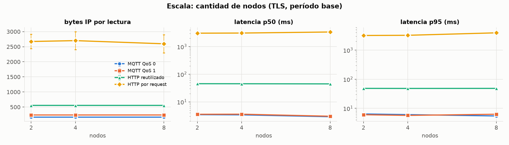

- **Bytes y paquetes por lectura no cambian con 2, 4 u 8 nodos** (por ejemplo, MQTT QoS 0:
  165,1 / 165,2 / 165,2 B). La latencia de MQTT y HTTP reutilizado tampoco: ni el broker ni el
  backend son un cuello de botella con 8 lecturas por segundo.
- **Lo único que crece es el tiempo de los handshakes:**
  - HTTP por request: 3,01 / 3,05 / 3,32 s de conexión con 2, 4 y 8 nodos;
  - MQTT QoS 0: 3,14 / 3,23 / 3,76 s.

  Es un efecto de la emulación: los 8 QEMU compiten por la CPU del host y la criptografía
  emulada tarda más. No refleja carga del servidor.

## 6. Período de envío

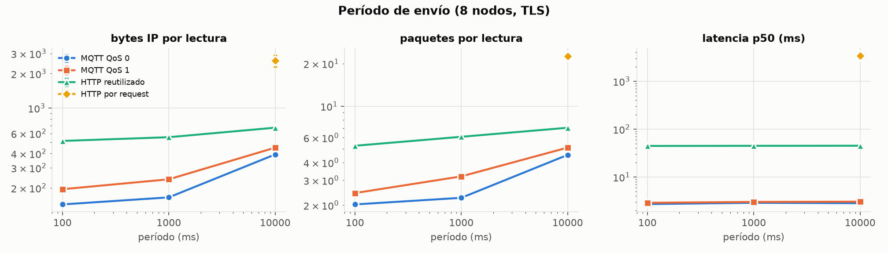

- **Bytes por lectura:** en los caminos persistentes bajan al acortar el período, porque el
  costo fijo se reparte entre más lecturas y los ACK viajan dentro del mensaje siguiente (ver el
  modelo de la sección 2).
- **Latencia:** no cambia con el período en MQTT.
- **HTTP reutilizado a 100 ms:** la mediana es 44,5 ms, pero el p95 sube a 705 ms. Las
  lecturas producidas durante el handshake de 3,9 s (~38 por nodo) se encolan y la cola se vacía
  despacio, porque cada lectura tarda ~45 ms (Nagle) contra 100 ms de período.
- **Con 10 s, MQTT tiene un p95 de ~19 ms** contra ~5 ms a 1 s. Lo explica la primera lectura de
  cada nodo, que pesa 1/12 de la muestra.

---

## 7. Pérdida de paquetes (pregunta 3)

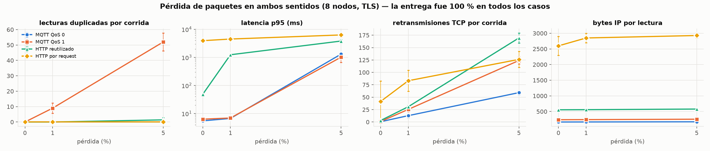

| | Pérdida | Entrega | Retransmisiones TCP / corrida | Duplicados | p95 | p99 | Δ bytes |
|---|---|---|---|---|---|---|---|
| MQTT QoS 0 | 1 % | 100 % | 12,8 | 0 | 6,7 ms | 941 ms | +0,9 % |
| | 5 % | 100 % | 59,2 | 0 | 1304 ms | 3040 ms | +4,1 % |
| MQTT QoS 1 | 1 % | 100 % | 25,4 | 9,0 | 6,9 ms | 617 ms | +1,5 % |
| | 5 % | 100 % | 124,0 | 52,0 | 1017 ms | 1749 ms | +7,1 % |
| HTTP reutilizado | 1 % | 100 % | 30,8 | 0 | 1238 ms | 3164 ms | +0,7 % |
| | 5 % | 100 % | 169,4 | 1,4 | 3810 ms | 6638 ms | +4,3 % |
| HTTP por request | 1 % | 100 % | 83,2 | 0 | 4491 ms | 4784 ms | +9,7 % |
| | 5 % | 100 % | 126,2 | 0 | 6287 ms | 8492 ms | +12,8 % |

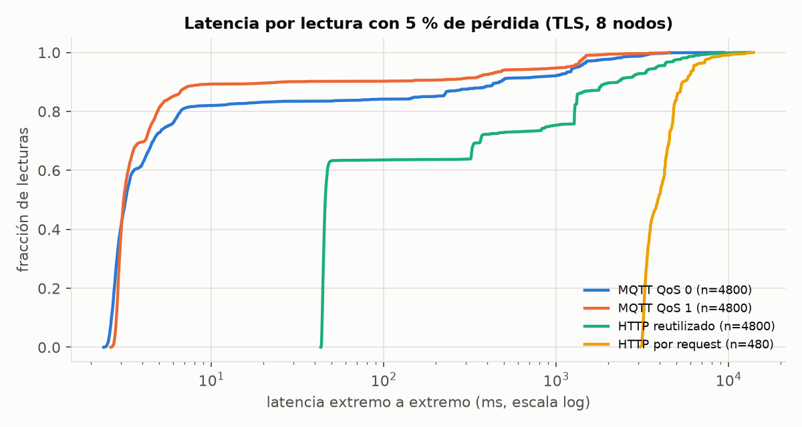

**La entrega no se degrada.** TCP retransmite cada segmento perdido y ninguna sesión se cayó
(0 desconexiones MQTT). QoS 0 solo perdería lecturas si se corta la conexión: por ejemplo, si
vence el keep-alive, hay un reset o el nodo se reconecta al WiFi. Eso no ocurre con ≤5 % de
pérdida aleatoria en 120 s. **QoS 1 no mejora la entrega en estas condiciones, solo suma
duplicados** (5,4 % de las lecturas con 5 % de pérdida). Los produce esp-mqtt al reenviar el
PUBLISH si no llegó el PUBACK en 1 s, mientras TCP todavía está recuperando.

**Lo que se degrada es la cola de latencia,** y la CDF muestra saltos en valores fijos:

- **~1 a 1,5 s: el RTO de lwIP.** Un segmento perdido se recupera recién cuando vence el
  temporizador de retransmisión, que lwIP maneja con un reloj de 500 ms. No hay retransmisión
  rápida: con una lectura por segundo nunca hay 3 ACK duplicados.
- **~0,05 a 0,5 s: bloqueo de cabeza de línea.** La lectura siguiente llega 1 s después, pero
  TCP no la entrega a la aplicación hasta que se recupera la anterior. Por eso las lecturas
  lentas vienen de a pares.
- **>2 s:** pérdidas repetidas con backoff exponencial del RTO.

**HTTP sale mucho peor: 37 % de las lecturas tarda más de 50 ms, contra 16 % en QoS 0 y 10 %
en QoS 1.** El cliente HTTP es pedido-respuesta y en serie:

- cualquier paquete perdido, en cualquier sentido, frena el envío hasta que se recupera;
- las lecturas siguientes esperan en la cola;
- cada lectura usa 6 paquetes (22 en HTTP por request) contra 2 o 3 de MQTT, así que tiene más
  chances de perder alguno.

Con 5 % de pérdida, HTTP reutilizado tuvo además 1,6 errores por corrida (timeout de 5 s y
reintento de la aplicación), que dejaron 1,4 duplicados.

**QoS 1 tiene mejor cola que QoS 0** (p99 1,7 s contra 3,0 s), aunque la diferencia de p95 no es
significativa (p = 0,16). La explicación más probable está en los ACK perdidos de bajada:

- **En QoS 0** el broker solo manda ACKs sin datos. Si uno se pierde, el nodo no lo sabe hasta que
  vence su RTO (≥1 s), y mientras tanto Nagle retiene la lectura siguiente, porque hay datos sin
  confirmar. En las capturas, el nodo reenvía en promedio **54 segmentos por corrida que ya
  habían llegado al servidor en QoS 0, contra 4,6 en QoS 1**. Es lo esperable si se pierde el
  5 % de los ~960 ACKs de bajada (~48). Son segmentos con la misma secuencia ya capturada en el
  bridge: la pérdida de subida ocurre antes del bridge y no deja copia.
- **En QoS 1** el ACK viaja dentro del PUBACK, que es un dato. Si se pierde, lo retransmite Linux
  con su RTO de ~200 ms, mucho antes que lwIP.

**El costo en bytes de la pérdida es bajo** (+1 % a +13 %). El mayor es el de HTTP por request,
porque además de las pérdidas suben las retransmisiones espurias del handshake.

---

## 8. Latencia de red (pregunta 3)

Latencias **corregidas** por el sesgo del reloj (−RTT/2, sección 1):

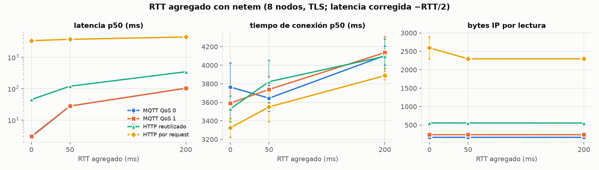

| p50 corregida | RTT 0 | RTT 50 ms | RTT 200 ms | Δ con 200 ms | Δ en RTT |
|---|---|---|---|---|---|
| MQTT QoS 0 | 2,9 ms | 27,8 ms | 102,7 ms | +99,8 ms | **0,5** |
| MQTT QoS 1 | 3,0 ms | 27,9 ms | 102,9 ms | +99,9 ms | **0,5** |
| HTTP reutilizado | 44,8 ms | 119,5 ms | 344,6 ms | +299,8 ms | **1,5** |
| HTTP por request + TLS | 3383 ms | 3728 ms | 4434 ms | +1051 ms | **~5,3** |

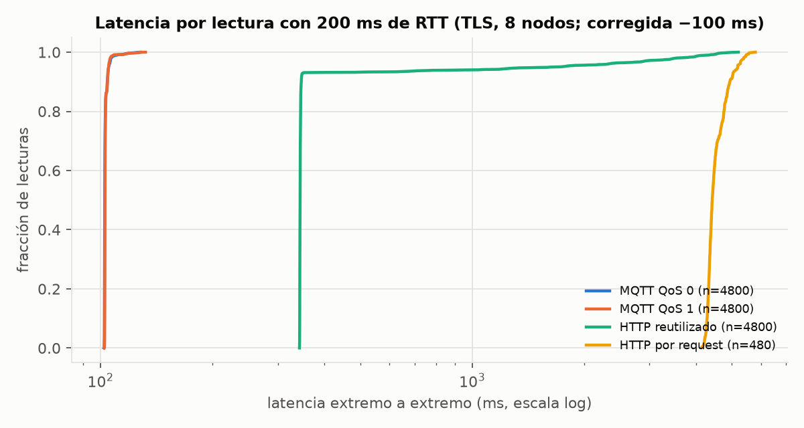

- **MQTT paga solo el viaje de ida** (0,5 RTT): el PUBLISH sale y llega, sin esperar nada.
- **HTTP reutilizado paga 1,5 RTT:** el viaje de ida más un RTT completo de Nagle, porque el cuerpo
  espera el ACK de los headers. Con latencia alta, la penalidad de Nagle deja de ser 40 ms y pasa
  a ser **un RTT por lectura**.
- **HTTP por request con TLS paga ~5,5 RTT** antes de que el cuerpo llegue al servidor:
  - 1 del handshake TCP;
  - 2 del handshake TLS 1.2;
  - 1 de la espera de Nagle dentro del handshake (Client Key Exchange y luego Change Cipher
    Spec + Finished);
  - 0,5 de los headers;
  - 1 de Nagle entre headers y cuerpo.

  Medido: 5,3 RTT con 200 ms. Con 50 ms da 6,9 RTT, pero el desvío de HTTPS por request
  (±100 a 160 ms) es del orden de lo que se mide. Sin Nagle serían 3,5 RTT, y con TLS 1.3, 2,5.
- El tiempo de conexión (SYN → fin del handshake, visto desde el servidor) sube ~560 ms con
  200 ms de RTT, unos 3 RTT. Sobre esto pesan los ~3,3 s de criptografía emulada.
- **Bytes:** la latencia no cambia los bytes de los caminos persistentes. En HTTP por request los
  **baja** (2596 → 2297 B), porque desaparecen las retransmisiones espurias (sección 10).

---

## 9. Serialización: protobuf vs JSON

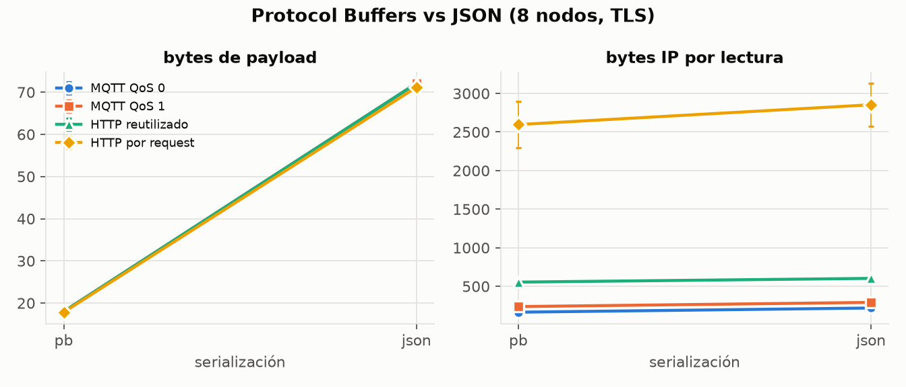

| | Payload pb | Payload JSON | B/lectura pb | B/lectura JSON | Δ | Δ relativo |
|---|---|---|---|---|---|---|
| MQTT QoS 0 | 18,0 B | 72,1 B | 165,2 | 219,4 | +54,2 B | **+32,8 %** |
| MQTT QoS 1 | 18,0 B | 72,1 B | 237,7 | 291,9 | +54,2 B | +22,8 % |
| HTTP reutilizado | 18,0 B | 72,1 B | 555,0 | 603,2 | +48,2 B | +8,7 % |
| HTTP por request | 17,8 B | 71,2 B | 2296,6 | 2357,7 | +61 B | +2,7 % |

*HTTP por request: corridas sin retransmisiones espurias. Con todas las corridas el desvío
(±280 B) tapa la diferencia (p = 0,2).*

- **JSON es 4 veces más grande** que protobuf para este mensaje, y agrega los mismos ~54 B en todos
  los caminos. En HTTP son 6 B menos, porque `application/json` es más corto que
  `application/x-protobuf` en el header Content-Type.
- **El efecto relativo es mucho mayor en MQTT,** donde el payload es una fracción grande del
  mensaje.
- La latencia no cambia (el cifrado y el envío de 54 B más son despreciables).
- El payload protobuf varía entre 16 y 19 B porque `seq` es un varint: ocupa 1 B hasta 127 y
  2 B desde 128. Por eso el promedio es 18,9 B con período de 100 ms, que llega a seq 1199.

---

## 10. Retransmisiones espurias y variabilidad de HTTPS por request

HTTP por request + TLS es la única configuración con desvío grande (2596 ± 298 B). La
variabilidad se explica entera por retransmisiones (correlación 1,000 entre corridas):

```
bytes por lectura − payload = 2279 B + 692 B × (retransmisiones / lectura)
```

692 B es el primer bloque de mensajes del servidor en el handshake (ServerHello, certificado y
ServerKeyExchange: 655 B de TLS + 40 de TCP/IP), retransmitido **sin haberse perdido**:

1. El ESP32 recibe ese bloque y se pone a calcular su parte del handshake (~3 s en QEMU).
2. Su ACK sale con el temporizador de ACK retardado de lwIP, entre ~200 y 250 ms después.
3. Si el RTO del servidor Linux es menor que esa espera (mínimo 200 ms + RTT), el servidor
   retransmite.

Por corrida da 0, ~43 o ~87 retransmisiones: el fenómeno se repite en casi todas las
conexiones de una corrida o en ninguna. La causa probable es que **Linux guarda métricas
TCP por destino** (`ip tcp_metrics`). Al terminar la matriz había, para las IP de los nodos,
RTT en caché de 5 a 97 ms y rttvar de 7 a 116 ms, heredados de corridas anteriores (por ejemplo,
las de RTT 200). Con un RTT en caché alto, el RTO inicial supera la espera de lwIP y no hay
retransmisión. Por eso:

- con RTT agregado de 50 o 200 ms nunca hubo retransmisiones (2296 ± 1 B);
- entre corridas sin RTT agregado el resultado depende de qué corrió antes.

No se aisló con un experimento aparte. Para futuras corridas conviene
`ip tcp_metrics flush all` antes de cada una, o `sysctl net.ipv4.tcp_no_metrics_save=1`.

**Valor de referencia de HTTPS por request: 2296 B por lectura** (sin retransmisiones
espurias). El promedio de 2596 B es el que dio este banco con este estado de TCP.

---

## 11. Hipótesis del documento

| Hipótesis | Resultado |
|---|---|
| MQTT envía menos bytes por lectura que HTTPS, y la diferencia crece con períodos cortos. | **Se confirma, con un matiz.** MQTT gana en todos los casos medidos (n ≥ 12 lecturas por conexión). La ventaja relativa crece al acortar el período: contra HTTP reutilizado es ×1,7 a 10 s, ×3,4 a 1 s y ×3,6 a 100 ms. El motivo es que MQTT tiene el costo por lectura más bajo pero el costo fijo por conexión más alto. Si la conexión dura menos de ~3 lecturas, la relación se invierte. |
| HTTPS reutilizado reduce gran parte de la diferencia, pero los headers HTTP siguen pesando más que la cabecera MQTT. | **Se confirma.** Reutilizar la conexión baja HTTPS de 2296 a 555 B (−76 %), pero sigue siendo 3,4 veces MQTT QoS 0. Pesan los headers (134 a 153 B contra 13 B de cabecera MQTT con el tópico), la respuesta obligatoria y los ACK extra, más +40 ms por Nagle. |
| HTTPS con una conexión por request es el caso más costoso, sobre todo con TLS y latencia alta. | **Se confirma.** Es el más caro en bytes (×3,1 con TLS) y en latencia, y es el único que con 200 ms de RTT paga ~5,5 RTT por lectura. |
| Con pérdida, MQTT QoS 1 mantiene la entrega a costa de duplicados, y QoS 0 pierde lecturas. | **Se confirma a medias.** QoS 1 sí genera duplicados (5,4 % con 5 % de pérdida). Pero **QoS 0 no perdió ninguna lectura**: TCP recupera todo mientras la sesión no se corte. La diferencia entre QoS 0 y QoS 1 aparece con desconexiones, que no ocurrieron. En cambio, QoS 1 tuvo mejor cola de latencia. |
| Protobuf reduce el tamaño en ambos caminos, con efecto relativo mayor en MQTT. | **Se confirma.** El ahorro absoluto es igual en todos los caminos (~54 B). El relativo es 33 % en MQTT QoS 0, 9 % en HTTP reutilizado y 3 % en HTTPS por request. |

---

## 12. Limitaciones y amenazas a la validez

- **Criptografía emulada.** Los handshakes TLS tardan ~3 a 3,8 s en QEMU. Los tiempos de conexión y
  la latencia de HTTPS por request son relativos, no absolutos. Los bytes y paquetes sí son los
  del firmware real (lwIP, mbedTLS, esp-mqtt y esp_http_client sin cambios).
- **Reloj.** El SNTP de lwIP no compensa el viaje de ida y vuelta. Las latencias con RTT agregado
  se corrigieron restando RTT/2. Sin RTT agregado, la incertidumbre absoluta es de ~1 ms.
- **Estado compartido entre corridas.** Linux guarda métricas TCP por destino (sección 10). Afecta
  las retransmisiones espurias, que solo pesan en HTTPS por request.
- **Diseño un factor a la vez.** No se midieron interacciones, por ejemplo pérdida × período o
  latencia × JSON. La única interacción medida es Nagle × TLS, en [nagle.md](nagle.md).
- **Configuración concreta.**
  - Nagle activo (por defecto) en HTTP.
  - Mosquitto manda la cadena con el certificado de la CA (+411 B por handshake de MQTT).
  - Sin reanudación de sesión TLS.
  - TLS 1.2 con AES-128-GCM (TLS 1.3 ahorraría un RTT en el handshake y 7 B por registro).
  - Keep-alive MQTT de 60 s, sin uso en estos períodos.
  - HTTP abre la conexión en el primer envío.

  Otras configuraciones darían otros números, en especial `C` y la latencia de HTTP.
- **Red emulada.** Ethernet emulado (QEMU no emula WiFi), y pérdida aleatoria independiente
  (netem sin ráfagas). Con pérdidas en ráfaga o cortes, las sesiones podrían caerse y ahí sí QoS 0
  perdería lecturas.
- **Corridas de 120 s.** Las sesiones nunca duran lo suficiente como para medir el keep-alive ni
  reconexiones. La proyección diaria supone que la conexión no se cae.
- **Arranque.** Las corridas 1 a 11 usaron el firmware con 30 s de espera para SNTP y las demás
  con 90 s. La diferencia está antes de que el nodo empiece a medir.

---

## 13. Reproducir

```bash
sudo ./backend/bin/runner     # matrices/principal.yaml → datos/principal (~7 h 40 min; retoma si se corta)
./backend/bin/analyze         # datos/principal/metrics.csv y summary.csv
uv run --with pandas --with matplotlib --with scipy analysis/figuras.py   # docs/resultados/figs
```

Desde `experimento/`. Los comandos y los archivos están explicados en el [README del experimento](../../README.md).

| Archivo | Contenido |
|---|---|
| `datos/principal/summary.csv` | 42 configuraciones, media y desvío de ~36 métricas |
| `datos/principal/metrics.csv` | 210 corridas, una fila por corrida |
| [`figs/tablas.md`](figs/tablas.md) | Tabla completa por configuración, intervalos de confianza y tests de Welch |
| `figs/composicion_bytes.csv`, `figs/modelo_costo.csv` | Datos de las figuras 2 y 13 |
| `datos/principal/runner.log` | Log del runner |
