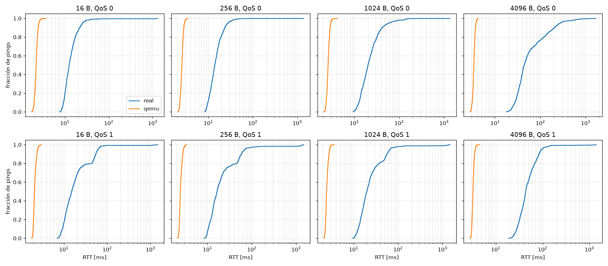
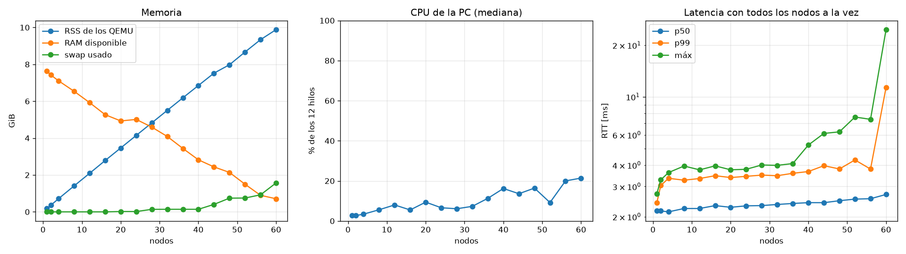
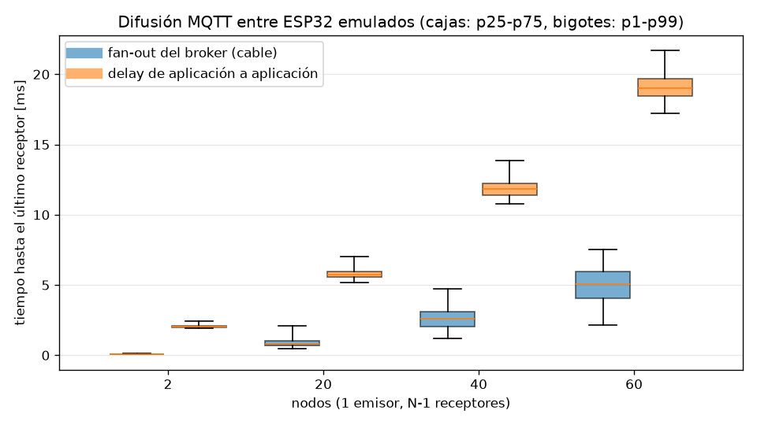
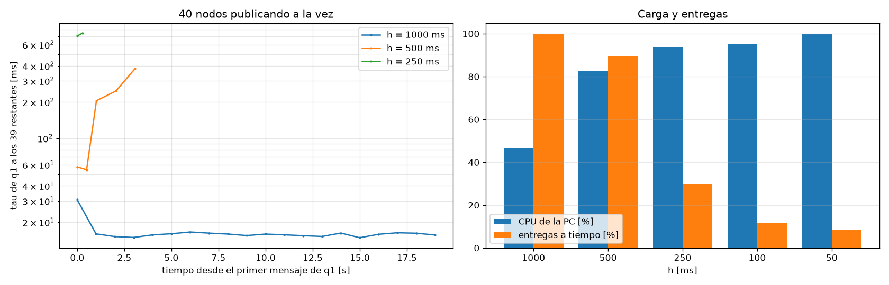
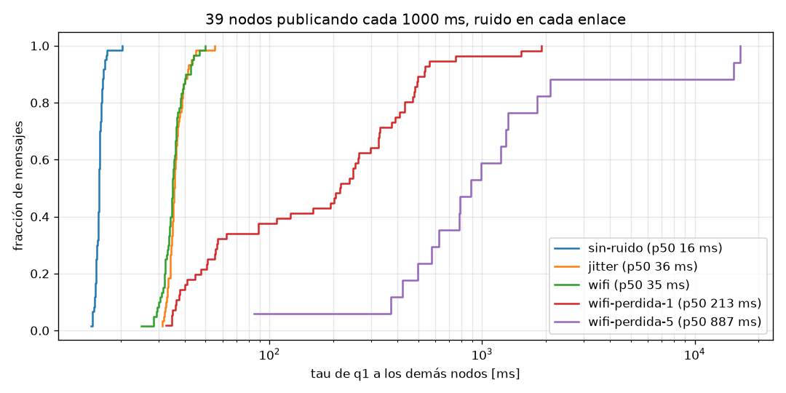

# Eco MQTT: ESP32 real contra ESP32 emulado

Mide latencia (RTT) y throughput de MQTT entre la PC y un ESP32, con la placa real por WiFi y con
el ESP32 emulado en QEMU, usando el mismo firmware, el mismo broker y el mismo programa de medición.

- `firmware/`: nodo ESP-IDF. Devuelve cada mensaje de `eco/<id>/ping` en `eco/<id>/pong`; ante
  `flood N S Q` en `eco/<id>/cmd` publica N mensajes de S bytes en `eco/<id>/flood` (con QoS 1, como
  mucho 20 sin PUBACK). Se compila con WiFi (placa real) o con Ethernet openeth (QEMU).
- `backend/`: programa Go. `eco suite` corre todas las pruebas; `eco compare` arma la tabla.
- `mosquitto.conf`: broker. `qemu.sh`: arranca el nodo emulado. `graficar.py`: CDF del RTT.
- `nodos.sh`, `escalar.sh`, `monitor.py`, `graficar_escala.py`: muchos nodos QEMU en paralelo sobre
  tap + puente (ver [Escalado](#escalado-cuántos-esp32-emulados-entran-en-la-pc)).
- `difusion.sh`, `analizar_difusion.py`, `graficar_difusion.py`: delay de un nodo a todos los demás
  (ver [Difusión](#delay-de-difusión-un-nodo-a-todos-los-demás)).
- `todos.sh`, `analizar_todos.py`, `graficar_todos.py`: todos los nodos publicando cada h
  (ver [Todos-a-todos](#todos-a-todos-qué-período-de-publicación-aguanta-la-pc)).
- `ruido.sh`, `ruido_medir.sh`, `graficar_ruido.py`: ruido de red con `netem` en cada enlace
  (ver [Ruido](#ruido-de-red-jitter-y-pérdida-en-los-40-enlaces)).

El RTT es el viaje completo PC → broker → ESP32 → broker → PC, medido con el reloj de la PC (no hace
falta sincronizar relojes). Se manda un ping por vez y 10 ms después del eco el siguiente; los
primeros 20 se descartan. El throughput es el del ESP32 hacia la PC: tasa de llegada de un flood.

## Cómo correrlo

```bash
. ~/esp/esp-idf/export.sh
mosquitto -c mosquitto.conf &
cd backend && go build -o eco . && cd ..

# QEMU
cd firmware && idf.py -B build-qemu -D SDKCONFIG=build-qemu/sdkconfig \
    -D SDKCONFIG_DEFAULTS="sdkconfig.defaults;sdkconfig.defaults.qemu" build && cd ..
./qemu.sh &                                 # esperar "eco: conectado a ..."
./backend/eco -label qemu suite

# Placa real: crear firmware/sdkconfig.defaults.local con SSID, contraseña y URI del broker
# (ver sdkconfig.defaults.real) y apagar QEMU antes de medir.
cd firmware && idf.py -B build-real -D SDKCONFIG=build-real/sdkconfig \
    -D SDKCONFIG_DEFAULTS="sdkconfig.defaults;sdkconfig.defaults.real;sdkconfig.defaults.local" \
    -p /dev/ttyACM0 build flash && cd ..
./backend/eco -node real -label real suite

./backend/eco compare resultados/real resultados/qemu
python3 graficar.py resultados/real resultados/qemu
```

El firewall de la PC tiene que dejar entrar al puerto del broker desde la LAN. En la corrida de
abajo el 1883 estaba cerrado y la placa usó el segundo listener (53317/tcp), que ya estaba abierto.

## Corrida del 27/10/2026

- PC: Arch Linux, WiFi en la red principal (2,4 GHz, canal 1), mosquitto 2.1.2, Go 1.27.1.
- Placa: ESP32-D0WD-V3 rev 3.1 (USB CH9102), ESP-IDF v5.5.6, ahorro de energía del WiFi apagado.
  No pudo autenticarse en la red principal (RSSI -77 dBm, AUTH_EXPIRE) y se conectó a un punto de
  acceso secundario (RSSI -78 dBm, canal 9), que le hace NAT dentro de la red de la PC. Camino real:
  ESP32 →(WiFi)→ punto de acceso secundario → NAT → red principal →(WiFi)→ PC.
- QEMU: Espressif 9.2.2, red de usuario (slirp) con openeth, misma PC.
- 1000 pings y 2000 mensajes de flood por caso.

| prueba | bytes | QoS | p50 real [ms] | p50 QEMU [ms] | p99 real [ms] | p99 QEMU [ms] | jitter real [ms] | jitter QEMU [ms] | kbit/s real | kbit/s QEMU |
|---|---|---|---|---|---|---|---|---|---|---|
| latencia | 16 | 0 | 12,5 | 2,2 | 42,9 | 2,8 | 15,4 | 0,19 | | |
| latencia | 256 | 0 | 14,0 | 2,5 | 41,4 | 3,1 | 9,1 | 0,19 | | |
| latencia | 1024 | 0 | 20,1 | 2,6 | 135,8 | 3,2 | 18,5 | 0,21 | | |
| latencia | 4096 | 0 | 43,9 | 3,4 | 745,4 | 4,0 | 59,6 | 0,22 | | |
| latencia | 16 | 1 | 15,2 | 2,1 | 94,5 | 2,7 | 38,3 | 0,16 | | |
| latencia | 256 | 1 | 16,3 | 2,4 | 1283,8 | 3,1 | 61,7 | 0,17 | | |
| latencia | 1024 | 1 | 19,8 | 2,5 | 1097,9 | 3,1 | 46,3 | 0,18 | | |
| latencia | 4096 | 1 | 43,4 | 3,3 | 148,4 | 3,9 | 36,4 | 0,18 | | |
| throughput | 16 | 0 | | | | | | | 121 | 263 |
| throughput | 256 | 0 | | | | | | | 718 | 4128 |
| throughput | 1024 | 0 | | | | | | | 738 | 16439 |
| throughput | 4096 | 0 | | | | | | | 684 | 40328 |
| throughput | 16 | 1 | | | | | | | 11 | 3 |
| throughput | 256 | 1 | | | | | | | 63 | 713 |
| throughput | 1024 | 1 | | | | | | | 113 | 2639 |
| throughput | 4096 | 1 | | | | | | | 1090 | 12026 |

Jitter: variación media entre RTT consecutivos. Pérdidas: 0 en QEMU; en la placa, entre 0 y 0,6 %
de los pings (más de 2 s sin eco). El 20 % de "pérdida" del flood real de 256 B con QoS 1 es un
corte del medidor: la llegada se frenó más de 3 s y se dio la prueba por terminada.



## Qué muestra

- **La emulación no agrega ruido: lo saca.** En QEMU el RTT es de 2–3 ms con desvío de 0,2 ms y
  es casi independiente del tamaño. En la placa real es de 12–44 ms en la mediana, el jitter es
  50–360 veces mayor y la cola llega a 1,3–1,7 s en todos los casos. Lo que domina es el enlace
  WiFi (dos tramos inalámbricos con señal débil), que QEMU no modela: su red es un socket local.
- **El costo del tamaño es otro.** De 16 B a 4 KB el RTT real sube unos 31 ms (unos 2 Mbit/s
  efectivos ida y vuelta); en QEMU, 1,2 ms. El throughput real se satura en unos 0,7 Mbit/s
  con QoS 0 desde 256 B; QEMU llega a 40 Mbit/s, limitado solo por la CPU de la PC.
- **QoS 1 en la placa real tiene un escalón** cerca del percentil 80 (unos 40 ms extra) que en
  QEMU no aparece. Es compatible con la interacción de Nagle en el ESP32 (PUBACK y PUBLISH del eco
  salen en dos escrituras chicas) con el ACK retardado de 40 ms de Linux; no está verificado con
  una captura.
- **El flood QoS 1 con mensajes chicos es lento en las dos plataformas** (11 y 3 kbit/s con 16 B),
  así que ese efecto es del protocolo y del firmware, no de la emulación.

Conclusión: QEMU sirve para validar la lógica del firmware y del protocolo (los mensajes, el QoS
y las pérdidas por bugs se reproducen igual; el agotamiento del heap con QoS 1 apareció primero en
QEMU) y da una línea de base estable y repetible. Sus tiempos no representan una placa real por
WiFi. Para acercarlos hace falta degradar el enlace de cada nodo con `netem` (tap + puente, como
plantea la sección de plataforma común) usando como referencia la distribución medida acá: unos
10 ms de base, una cola larga hasta ~1,5 s y unos 0,7 Mbit/s de techo.

## Escalado: cuántos ESP32 emulados entran en la PC

Con la red de usuario (slirp) cada QEMU tiene su propia red aislada. Para muchos nodos se usa una
interfaz **tap** por QEMU, todas unidas al puente `br-eco` (la PC es 10.10.0.1/16). Así los paquetes
del ESP32 llegan tal cual a la pila TCP/IP de Linux, y cada nodo queda con una interfaz propia sobre
la que se puede aplicar `netem`. La variante `tap` del firmware (`sdkconfig.defaults.tap`) lee su
índice del último sector de la flash (cada nodo usa su copia) y de ahí arma el ID `q<i>`, la MAC
`02:ec:00:00:xx:xx` y la IP fija 10.10.0.0 + 10 + i; sin DHCP, porque el firewall de la PC lo bloquea.

```bash
cd firmware && idf.py -B build-tap -D SDKCONFIG=build-tap/sdkconfig \
    -D SDKCONFIG_DEFAULTS="sdkconfig.defaults;sdkconfig.defaults.tap" build && cd ..
./nodos.sh up 8                             # sudo para el puente y las taps
./backend/eco -nodes 8 -label prueba multi  # latencia con los 8 a la vez
./nodos.sh down
./escalar.sh escala                         # escalado automático hasta el límite de RAM
python3 graficar_escala.py resultados/escala
```

`escalar.sh` suma nodos de a escalones (1, 2, 4, 8 y de a 4); en cada uno espera que todos se
conecten, deja 10 s de margen y hace 100 pings de 16 B por nodo, todos a la vez. `monitor.py`
registra cada segundo la RAM y la CPU de la PC y de los QEMU (`recursos.csv`). Se corta cuando
quedan menos de 800 MiB disponibles o se usa más de 1 GiB de swap: más allá la PC entra en swap
de verdad y el escritorio deja de responder.

### Corrida del 27/10/2026

PC: Ryzen 5 5600G (6 núcleos, 12 hilos), 13 GiB de RAM (unos 8 GiB libres con el escritorio
abierto), swap en zram + archivo, transparent huge pages en `always`.



| nodos | RSS QEMU [GiB] | RAM disp. [GiB] | swap [GiB] | CPU PC | RTT p50 [ms] | RTT p99 [ms] | RTT máx [ms] |
|---|---|---|---|---|---|---|---|
| 1 | 0,18 | 7,6 | 0 | 3 % | 2,17 | 2,42 | 2,7 |
| 8 | 1,4 | 6,5 | 0 | 6 % | 2,23 | 3,27 | 4,0 |
| 16 | 2,8 | 5,3 | 0 | 6 % | 2,32 | 3,47 | 4,0 |
| 32 | 5,5 | 4,1 | 0,14 | 7 % | 2,36 | 3,47 | 4,0 |
| 48 | 8,0 | 2,1 | 0,74 | 16 % | 2,48 | 3,80 | 6,2 |
| 56 | 9,3 | 0,9 | 0,92 | 20 % | 2,55 | 3,79 | 7,4 |
| **60** | **9,9** | **0,7** | **1,57** | 21 % | 2,70 | **11,3** | **24,7** |

Ningún ping se perdió en ningún escalón (6000 de 6000 con 60 nodos).

- **El límite es la RAM: unos 60 nodos en esta PC.** Cada QEMU ocupa unos 170 MB, lineal y sin
  compartir nada entre instancias (todo es memoria anónima privada: unos 90 MB de RAM/flash
  emuladas y código traducido, y unos 80 MB de heap). Con 60 nodos los QEMU usan 9,9 GiB.
- **La CPU sobra.** Un ESP32 emulado en reposo usa un 3–8 % de un núcleo; con 60 nodos la PC
  estuvo al 21 % (unos 2,5 de 12 hilos). La CPU se acabaría recién con varios cientos de nodos.
- **La latencia casi no cambia hasta que aparece el swap.** El p50 pasa de 2,2 a 2,6 ms entre 1 y
  56 nodos. Con 60 nodos el p99 se triplica (3,8 → 11,3 ms) y el máximo llega a 25 ms: cuando el
  kernel empieza a mandar páginas de los QEMU al swap, un nodo que vuelve a tocarlas se frena.
  Para medir sin ese ruido conviene quedarse por debajo de unos 50 nodos (o del 80 % de la RAM).
- **Achicar la caché de TCG no ayuda:** con `-accel tcg,tb-size=4` el RSS baja de 182 a 163 MB.
  Lo que podría ayudar son dos ajustes globales de la PC que no se tocaron: activar KSM
  (`/sys/kernel/mm/ksm/run`), que fusiona páginas idénticas entre las 60 VMs (QEMU ya las marca
  como fusionables), y pasar las huge pages transparentes a `madvise` (unos 34 MB por nodo
  están en páginas de 2 MB).

## Delay de difusión: un nodo a todos los demás

Cuánto tarda un mensaje que publica un nodo en llegar a **todos** los demás, pasando por el broker.
Es el delay que va a ver cualquier experimento donde los nodos se escuchan entre sí.

Cada QEMU tiene su propio reloj, así que no se pueden restar tiempos de nodos distintos. El reloj
común es el de la PC: `difusion.sh` captura con `tcpdump` en `br-eco`, por donde pasa todo, mientras
q1 publica 200 mensajes de 16 B en `eco/todos` (uno cada 100 ms; `bcast N P S` en el firmware). De
la captura (`analizar_difusion.py`) salen, para cada mensaje y cada receptor i:

- **T0**: llega a la PC el PUBLISH de q1.
- **Ti**: mosquitto le manda el PUBLISH al receptor i. **Fan-out del broker** = Ti − T0.
- **Ai**: llega a la PC el ack con el que el receptor devuelve el mensaje apenas lo recibe.
  **Vuelta en el ESP32** = Ai − Ti: subir el paquete por lwIP y esp-mqtt hasta la aplicación y bajar
  el ack.

El tramo del emisor (aplicación → cable) no se ve en la captura. El **delay de aplicación a
aplicación** hasta el último receptor se estima por mensaje como `s + máx_i (Ti − T0 + vuelta_i / 2)`,
con `s` = la mitad de la vuelta con 2 nodos (0,98 ms: el emisor publica sin competencia de CPU) y
la vuelta repartida por mitades entre subida y bajada.

```bash
./difusion.sh difusion                       # NODOS="2 20 40 60" MSGS=200 PERIODO_MS=100 BYTES=16
python3 graficar_difusion.py resultados/difusion
```

### Corrida del 27/10/2026

Misma PC que el escalado. 200 difusiones por caso; no se perdió ninguna entrega (11 800 de 11 800
con 60 nodos). Con 60 nodos la PC estuvo con 1,3 GiB de swap.

| nodos | fan-out del broker a todos p50 / p99 [ms] | vuelta en el ESP32 p50 [ms] | **delay a todos** p50 / p95 / p99 / máx [ms] |
|---|---|---|---|
| 2 | 0,08 / 0,14 | 1,96 | **2,0** / 2,2 / 2,4 / 2,5 |
| 20 | 0,83 / 2,10 | 6,21 | **5,7** / 6,4 / 7,0 / 9,0 |
| 40 | 2,57 / 4,72 | 13,08 | **11,8** / 13,3 / 13,9 / 22,2 |
| 60 | 5,08 / 7,51 | 20,98 | **19,0** / 20,8 / 21,7 / 22,2 |



- **El delay de la simulación crece lineal con los nodos: unos 0,3 ms por nodo** (2 ms con 2 nodos,
  19 ms con 60). Es muy estable: con 60 nodos el p99 está solo 3 ms arriba de la mediana.
- **El broker no es el cuello de botella.** Mosquitto entrega a los 59 receptores en 5 ms (unos
  85 µs por receptor, incluido el bridge del kernel), y eso compitiendo por la CPU con los QEMU.
- **Casi todo el delay es CPU de la PC, no red.** La vuelta en el ESP32 sigue casi exacto
  `(N − 1) × 2 ms / 6`: 6,3 / 13,0 / 19,7 ms contra 6,2 / 13,1 / 21,0 medidos. Cuando llega una
  difusión, todos los QEMU se despiertan a la vez y se reparten los 6 núcleos físicos de la PC
  (12 hilos, pero los dos hilos de un núcleo no rinden el doble). En ESP32 reales cada uno tiene su
  CPU y esa espera no existe: el delay real sería del orden de 2 ms más el enlace (en WiFi, 12–44
  ms de RTT según la primera parte), sin la pendiente de 0,3 ms por nodo.
- **Consecuencia para los experimentos:** con más de unos 10 nodos, el delay de la simulación está
  dominado por la cantidad de nodos emulados y no por MQTT. Hay que reportarlo como un artefacto de
  la plataforma, o mantenerlo constante (misma cantidad de nodos y misma PC) al comparar.
- **Sesgo de la medición:** el ack de cada receptor también consume CPU de la PC justo durante la
  difusión, así que este delay es algo mayor que el de una difusión sin respuesta. Es lo esperable
  si todos los nodos publican, como en el experimento de sincronización.

## Todos-a-todos: qué período de publicación aguanta la PC

En el experimento de sincronización publican todos los nodos: cada h ms, cada uno manda su fase a
`eco/todos`. Cada ronda son N·(N−1) entregas (1560 con 40 nodos), así que la carga de la PC crece
con N² / h. `todos.sh` levanta los nodos y, para cada h, hace publicar a los 40 durante 20 s
(`bcast N h S A`). Solo q1 pide ack (A = 1): es el emisor de prueba, y los otros 39 generan la
carga sin duplicar el tráfico con acks. El τ de q1 a los 39 restantes se calcula como en la
difusión, pero con `s` = la mitad de la vuelta medida en la misma corrida, porque acá el emisor
también compite por la CPU. Solo cuentan los mensajes de q1 que llegaron y volvieron de los 39.

```bash
./todos.sh todos                             # NODOS=40 HS="1000 500 250 100" DUR_S=20 BYTES=16
python3 graficar_todos.py resultados/todos
```

### Corrida del 27/10/2026 (40 nodos)

| h [ms] | entregas/s | CPU de la PC | entregas a tiempo | τ p50 / p99 [ms] | τ al principio → al final (p50) [ms] |
|---|---|---|---|---|---|
| **1000** | 1560 | 47 % | **100 %** | **15,9 / 30,8** | 15,7 → 15,9 (estable) |
| 500 | 3120 | 83 % | 90 % | 205 / 377 | 58 → 377 (crece) |
| 250 | 6240 | 94 % | 30 % | 707 / 747 | — |
| 100 | 15 600 | 95 % | 12 % | — | — |
| 50 | 31 200 | 100 % | 8 % | — | — |

"Entregas a tiempo": las que salieron del broker antes de 5 s después del último envío. Los τ
con h ≤ 500 ms salen de muy pocos mensajes (5 de 40 de q1 llegaron a los 39 con h = 500 ms;
2 de 80 con h = 250 ms): solo muestran el orden de magnitud.



- **Con 40 nodos, la PC solo aguanta h = 1 s.** Ahí τ es estable, de unos 16 ms (p99 31 ms),
  algo más que los 12 ms con un solo emisor porque ahora hay carga de fondo, y no se pierde
  nada. Con h = 500 ms la CPU llega al 83 %: se forma una cola que crece sin parar (τ pasa de 58
  a 377 ms en pocos segundos) y el 10 % de las entregas no sale a tiempo. Con h ≤ 250 ms el
  sistema colapsa, y 3 nodos llegaron a cortar y rehacer la conexión con el broker.
- **Cada entrega le cuesta a la PC unos 3,6 ms de hilo** (47 % de 12 hilos con 1560
  entregas/s), contando recibir el paquete y procesarlo en el ESP32 emulado, el broker y el
  kernel. Para estimar otras combinaciones: CPU ≈ N·(N−1)·3,6 ms / (12·h), y conviene quedarse por
  debajo del 50 %: N·(N−1) / h ≲ 1700 entregas/s. Por ejemplo, 20 nodos (380 entregas por ronda)
  aguantarían h ≈ 250 ms.
- **Consecuencia para el modelo:** con N = 40 y h = 1 s, el retardo de la información vieja
  (unos h/2 = 500 ms) es 30 veces mayor que el de la red (16 ms). A 1 Hz eso pone ω̄·τ cerca de
  π y rompe el estado en fase. Para usar 40 nodos hace falta bajar la frecuencia de parpadeo
  (a 0,1 Hz, ω̄·h/2 ≈ 0,31 rad) o que cada nodo extrapole la fase recibida. Si no, hay que bajar
  N para poder bajar h.

## Ruido de red: jitter y pérdida en los 40 enlaces

Misma configuración que el experimento (40 nodos, h = 1 s, 60 s por perfil), con `netem` en el
enlace de cada nodo y **en los dos sentidos**: hacia el nodo en la salida de su tap, y desde el
nodo redirigiendo la entrada de la tap a un `ifb` con el mismo `netem` (`ruido.sh`). Se captura
en cada tap, del lado del nodo, así que los tiempos incluyen el ruido de subida y el de bajada.

| perfil | `netem` por sentido |
|---|---|
| sin-ruido | — |
| jitter | `delay 3ms slot distribution normal 4ms 2ms` |
| wifi | `delay 3ms slot distribution paretonormal 4ms 4ms` (cola larga) |
| wifi-perdida-1 | wifi + `loss 1%` |
| wifi-perdida-5 | wifi + `loss 5%` |

```bash
./ruido_medir.sh ruido                       # NODOS=40 H=1000 DUR_S=60 BYTES=16
python3 graficar_ruido.py resultados/ruido
```

### Corrida del 27/10/2026 (39 nodos: uno no llegó a conectarse)

τ **por par** (de q1 a cada receptor, que es lo que usa cada nodo en el modelo) y τ **hasta el
último** de los 38 receptores:

| perfil | τ por par p50 / p95 / p99 [ms] | pares > 150 ms | τ al último p50 / p95 / máx [ms] | entregas a tiempo |
|---|---|---|---|---|
| sin-ruido | 13 / 16 / 17 | 0 % | 16 / 17 / 20 | 100 % |
| jitter | 27 / 36 / 40 | 0 % | 36 / 43 / 55 | 99,8 % |
| wifi | 24 / 37 / 42 | 0 % | 35 / 43 / 50 | 99,8 % |
| wifi-perdida-1 | 29 / **749** / **1372** | **7 %** | 213 / 749 / 1902 | 98,9 % |
| wifi-perdida-5 | 30 / **1537** / **2106** | **20 %** | 887 / 16 414 / 16 414 | 91,4 % |

"Entregas a tiempo": hasta 8 s después del último envío. La CPU de la PC quedó en 41–52 %, como
sin ruido: el ruido no cambia la carga.



- **El jitter suma retardo, pero no cambia la forma.** Con unos 5 ms variables por sentido, τ por
  par pasa de 13 a unos 25 ms y sigue siendo compacto (p99 ≈ 40 ms). Para el modelo es un τ algo
  mayor con un poco de ruido de fase.
- **La pérdida no se ve como pérdida, sino como retardo.** MQTT va sobre TCP: casi todo llega,
  pero tarde. Con 1 % de pérdida la mediana casi no cambia (29 ms), pero un 7 % de los pares
  espera una retransmisión, con retardos de cientos de ms a ~2 s, compatibles con timeouts de
  retransmisión de TCP (no se separó cuáles vienen del broker y cuáles del ESP32). Con 5 % es un
  20 % de los pares, con colas de 2 s y hasta 19 s (compatible con timeouts que se duplican uno
  tras otro), y un 9 % de entregas que no llegó en la ventana.
- **La pérdida se amplifica por el bloqueo en cabeza de línea.** Cada nodo tiene una sola
  conexión TCP con el broker: un segmento perdido hacia un nodo retiene detrás a todos los
  mensajes de los demás emisores hasta que se retransmite. Por eso 1 % de pérdida de paquetes
  termina afectando al 7 % de los pares, y "hasta el último receptor" la mediana ya es de 213 ms.
- **Para el modelo:** la distribución de τ con pérdida es bimodal (rápido, o una retransmisión
  entera). Confirma lo que plantea la monografía (en TCP, la pérdida aparece como retardo y
  jitter), y con un orden de magnitud: con el período de 1 s, 1 % de pérdida ya produce retardos
  de hasta 1,4 s en el 1 % de los pares, más que un período completo.

### Dos trampas de método

1. **`netem delay X Y` reordena paquetes,** aun con una `pfifo` hija (el `man tc-netem` dice que
   no, pero en este kernel 7.2 sí). TCP lo vive como pérdida: hubo unas 7000 retransmisiones en un
   minuto sin ninguna pérdida configurada. Para variar el retardo sin reordenar hay que usar
   `slot`, que libera los paquetes en ráfagas a intervalos aleatorios, como el 802.11. La corrida
   con el jitter que reordena quedó en `resultados/ruido-reordena/`: da τ parecidos, con muchas más
   retransmisiones.
2. **El disector MQTT de `tshark` pierde mensajes** cuando un flujo TCP tiene una retransmisión
   o un hueco: se desalinea y deja de reconocer ese flujo hasta el final, y parecía que se perdía
   hasta el 86 % de las entregas. `analizar_difusion.py` arma los flujos TCP a mano por número de
   secuencia y separa los mensajes MQTT él mismo. Sobre las capturas sin ruido da exactamente lo
   mismo que antes.
